

  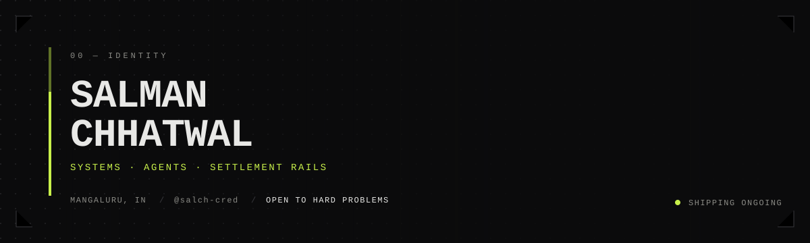

 

Full-stack and AI/ML engineer. Most of what I build sits under agents rather than inside them: settlement rails, permission layers, adjudication, the machinery that has to hold when nobody is watching.

I work upstream too: 374 pull requests and 58 commits to Nous Research's Hermes Agent, plus its plugin repos. TUI, gateway, tool layer, desktop runtimes, state stores, adapters.

 

 

 

| Working on | Role | State |
| --- | --- | --- |
| **PayMate** — non-custodial USDC billing rail for agents | author | live on GOAT mainnet |
| **MediVault** — private AI health vault on 0G | author | live, ERC-7857 contract on mainnet |
| **Hermes Agent** — agent runtime and plugin catalog | upstream contributor | 374 PRs · 58 commits |
| **GenLayer adjudication** — evidence-first verdict contracts | author | 4 protocols shipped |

 

 

  

 

  

 

Hermes is the agent that grows with you — a real agent runtime with desktop apps, gateways, channels, sandboxes, memory and a plugin catalog. I spend my time in the failure modes: a gateway that won't release a stale PID, a Windows profile path with non-ASCII characters, a WAL generation unlinked by a short-lived reader, an OAuth login that a single refresh can revive.

Shipped upstream:

| PR | What it fixes |
| --- | --- |
| [`hermes-agent#140922`](https://github.com/NousResearch/hermes-agent/pull/140922) | gateway: stamps an unproven `--replace` refusal as `startup_failed` so the next start wins |
| [`hermes-official-plugins#61`](https://github.com/NousResearch/hermes-official-plugins/pull/61) | directsdk: carries the login identity into the child env, captures native stderr |
| [`hermes-labs-plugins#3`](https://github.com/NousResearch/hermes-labs-plugins/pull/3) | record: an `autocomplete` token inside a list is still a secret field |

The patches themselves — all 58, every one in `hermes-agent`, spread over 20+ topic branches:

| Date | Commit |
| --- | --- |
| 2026-10-21 | `fix(gateway): log every missed liveness probe and dump the loop's task state` |
| 2026-10-21 | `fix(gateway): a retiring workspace takes no new work (#134889 TUI-27)` |
| 2026-10-21 | `fix(browser): an unbound thread resolves no configured CDP endpoint (#134889 GW-26)` |
| 2026-10-21 | `fix(checkpoints): pin literal pathspec mode for plan-owned git selections` |
| 2026-10-21 | `fix(checkpoints): drop oversize files from the index by literal pathspec` |
| 2026-10-21 | `fix(agent): serialize stdio installer transactions on the shared install lock` |
| 2026-10-20 | `fix(tools): do not drop a tool whose probe answered at the deadline` |
| 2026-10-20 | `fix(tools): bound a check_fn probe so a wedged availability check cannot hang the turn` |
| 2026-10-20 | `fix(approval): scope the git force-push patterns to the push's own command segment` |
| 2026-10-19 | `fix(stdio): never stack Hermes stdio proxies across the agent-build cycle (#139687)` |
| 2026-10-19 | `fix(prompt): render toolset-gated guidance in the volatile tier (#137307)` |
| 2026-10-19 | `test: tolerate bases without the redacting stdio wrapper in the proxy-depth helper` |
| 2026-10-18 | `fix(gateway): park a unit on unprovable --replace ownership instead of restart-looping` |
| 2026-10-18 | `fix(gateway): let the startup_failed stamp clear the way instead of parking the unit` |
| 2026-10-18 | `fix(gateway): make the ownership-refusal stamp durable before the hard exit` |
| 2026-10-07 | `fix(agent): gate the 20-image eviction trigger on the request's dimensions` |
| 2026-10-07 | `fix(anthropic): give the wire image-eviction pass the 24 MB request budget` |
| 2026-10-02 | `fix(state): key display identity of tool rows on stable tool identity, not payload bytes (#117750)` |
| 2026-09-29 | `fix(cron): keep a sticky last_failure stamp so a healed run stays visible` |
| 2026-09-27 | `fix(auth): treat nous as a single-use refresh pool provider` |
| 2026-09-27 | `fix(memory): migration note must not imply config.yaml provider keys still apply` |
| 2026-09-26 | `fix(backup): percent-encode path in _query_ro_sqlite URI` |
| 2026-09-14 | `fix(whatsapp): adapter reads WHATSAPP_GROUP_ALLOWED_USERS for the group allowlist (#72529)` |
| 2026-09-14 | `fix(discord): dispatch-side liveness dimension detects an ACKing-but-deaf gateway socket (#109521)` |
| 2026-09-13 | `fix(agent): same-model review fork inherits the parent's resolved cache scope (#109964)` |
| 2026-09-13 | `fix(mcp): skip dynamic tool refresh when the server session is already gone (#109824)` |
| 2026-09-13 | `fix(agent): mirror Claude Code OAuth refresh into the macOS Keychain (#98334)` |
| 2026-09-13 | `fix(discord): liveness probe gains a dispatch-side dimension (#109521)` |
| 2026-09-12 | `fix(desktop): do not fail build if get-windows is missing on any platform` |
| 2026-09-11 | `fix(kanban): preserve sticky block on tasks created with initial_status=blocked (#107398)` |
| 2026-09-11 | `fix(tui_gateway): handle deleted profiles gracefully in _response_profile_name (#107829)` |
| 2026-09-10 | `run: quiesce cron/deferred workers before DB close` |
| 2026-09-09 | `fix(serve): reserve ProcessLookupError for known missing process signals` |
| 2026-09-09 | `fix(serve): ensure parent-death watchdog detects exited Desktop parent (#80204)` |
| 2026-09-03 | `style: separate vitest import from local imports (perfectionist/sort-imports)` |
| 2026-09-03 | `fix(desktop): assistant rows whose text persisted to sidecars no longer vanish on rehydrate (#68321)` |
| 2026-09-03 | `lint: fix import ordering in chat-messages.reasoning-survival.test.ts` |
| 2026-09-02 | `fix(recovery): make the printed salvage command satisfy the real CLI contract` |
| 2026-09-02 | `fix(recovery): stop pointing sqlite3 .recover guidance at the live state.db` |
| 2026-09-01 | `refactor(gateway): drop constant conditional in rescue helper` |
| 2026-09-01 | `fix(update): break the cron-update three-way restart deadlock (#100179)` |
| 2026-09-01 | `fix(gateway): rescue orphaned FIFO overflow when session goes idle (#99882)` |
| 2026-08-31 | `fix(preview): use proper input events for React/contenteditable/sumbit in drive_preview type` |
| 2026-08-30 | `fix(agent): exempt :cloud GLM models from stop->length truncation rewrite` |
| 2026-08-30 | `fix(desktop): honour arrowed slash-picker highlight on bare '/' query` |
| 2026-08-30 | `test(agent): split GLM cloud/local stop-continuation cases` |
| 2026-08-29 | `fix(cron): accept bare duration units like 'hour' in schedule parsing` |
| 2026-08-29 | `fix(cron): mention bare units in the duration parse error` |

Open and in review: [gateway restart paths](https://github.com/NousResearch/hermes-agent/pull/142501) · [stale heartbeat requeues](https://github.com/NousResearch/hermes-agent/pull/142275) · [execute_code kernel memory caps](https://github.com/NousResearch/hermes-agent/pull/142249) · [wedged `check_fn` probes](https://github.com/NousResearch/hermes-agent/pull/142062) · [bounded inbound media download](https://github.com/NousResearch/hermes-official-plugins/pull/153) · [local-time timestamps in Home Assistant](https://github.com/NousResearch/hermes-official-plugins/pull/160).

**Surfaces touched:** TUI · gateway lifecycle · tool execution and output spilling · cron and heartbeats · desktop (Windows/macOS) · MCP · ACP · SQLite state, WAL, backups · compression and checkpointing · installers · Discord / WhatsApp / xchat adapters · DirectSDK · Spotify · Home Assistant.

  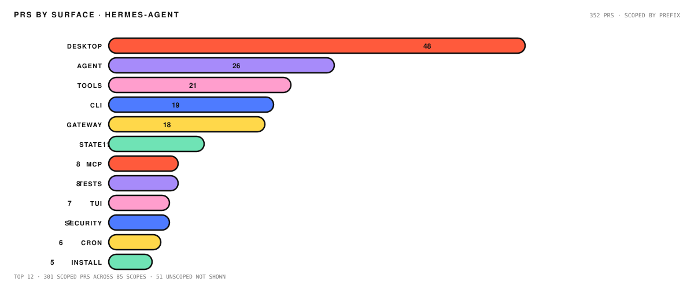

Also authored 10 Hermes skills published as standalone repos — [daily briefing](https://github.com/salch-cred/hermes-daily-briefing), [release radar](https://github.com/salch-cred/hermes-release-radar), [disk guard](https://github.com/salch-cred/hermes-disk-guard), [IP watchdog](https://github.com/salch-cred/hermes-ip-watchdog), [uptime digest](https://github.com/salch-cred/hermes-uptime-digest), [cert expiry](https://github.com/salch-cred/hermes-cert-expiry), [price digest](https://github.com/salch-cred/hermes-price-digest), [battery](https://github.com/salch-cred/hermes-battery), [dead link](https://github.com/salch-cred/hermes-dead-link), [folder size](https://github.com/salch-cred/hermes-folder-size).

 

 

  <a href="https://github.com/salch-cred/medivault">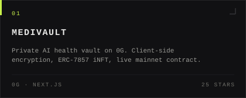</a>
  &nbsp;
  <a href="https://github.com/salch-cred/AgentPassport">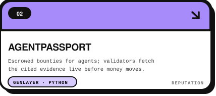</a>

  <a href="https://github.com/salch-cred/provenode">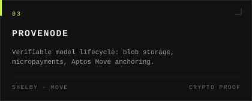</a>
  &nbsp;
  <a href="https://github.com/salch-cred/PolicyCourt">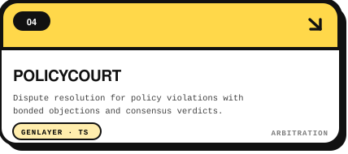</a>

  <a href="https://github.com/salch-cred/veritas-genlayer">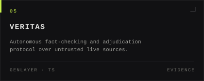</a>
  &nbsp;
  <a href="https://github.com/salch-cred/aerosure-genlayer">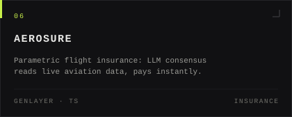</a>

  <a href="https://github.com/salch-cred/hydrasentinel">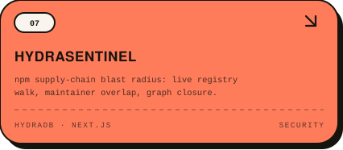</a>
  &nbsp;
  <a href="https://github.com/salch-cred/-Permitly">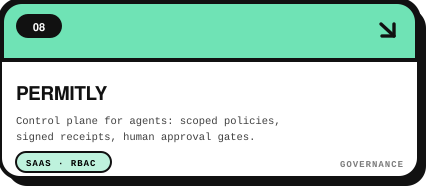</a>

  <a href="https://github.com/salch-cred/wefspan">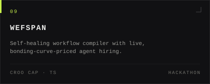</a>
  &nbsp;
  <a href="https://github.com/salch-cred/moovegate">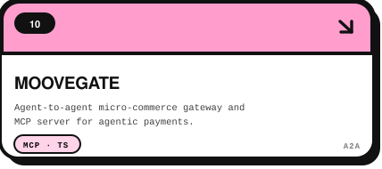</a>

  <a href="https://github.com/salch-cred/skillmint">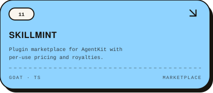</a>
  &nbsp;
  <a href="https://github.com/salch-cred/RialoScan">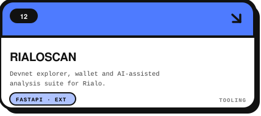</a>

 

**Also shipped:** [JanFix](https://github.com/salch-cred/janfix) (civic reporting, zero login, ward routing) · [Monaco CLOB dashboard](https://github.com/salch-cred/monaco-clob-dashboard) (Sei order book) · [SnakeCase](https://github.com/salch-cred/snakecase) (34-lesson Python curriculum) · [ZeroSense](https://github.com/salch-cred/zero-sense) (ZK robot proofs + Stellar micropayments) · [Reso](https://github.com/salch-cred/reso) (ZK compliance engine) · [Atropos fork](https://github.com/salch-cred/atropos) (LLM RL environments).

 

 

### The billing rail for the agent economy

Agents can chat, code and research. They cannot collect money. Invoices are PDFs, chasing is manual, and nothing exists for a per-call micropayment. Freelancers, meanwhile, have no portable proof that they finished anything.

[PayMate](https://github.com/salch-cred/paymate-new-) closes both sides: a freelancer or an agent creates an invoice or a paywalled endpoint, the client settles in **real USDC directly to the freelancer's wallet**, and every settlement mints a portable on-chain reputation credential. No custody of principal, no API-key gatekeeping.

**Live:** [paymateagent.xyz](https://www.paymateagent.xyz) · **Docs:** [paymateagent.xyz/docs](https://www.paymateagent.xyz/docs) · **Developers:** [paymateagent.xyz/developers](https://www.paymateagent.xyz/developers)

| Piece | Mechanism |
| --- | --- |
| Settlement | USDC on GOAT mainnet (chain 2345), client → freelancer wallet, verified on-chain |
| Agent billing | `POST /api/agent-billing` mints per-call x402 challenges; replay-guarded unlock |
| Reputation | ERC-8004 soulbound credential per settlement — travels with the agent |
| Escrow | `YieldEscrow` locks funds; PR merge or AI verdict releases them |
| Disputes | Mistral arbitrator rules against the original scope: pay / refund / split |
| Cross-chain | client signs one tx on any of 39 networks; relayer converts and settles in USDC |
| Zero-custody rail | swap → approve → bridge, DOGEB lands straight in the freelancer's wallet |
| Self-refill | BSC deposits pivot, bridge and DEX-swap into the payout pool automatically |
| Operator agent | audits the ledger, checks liquidity runway, retries failed swaps under hard USD caps |

Deployed and verifiable — `YieldEscrow` `0xEbe3BE16d7fd69268BcADdB6DB25C60dFff302e0`, `PayMateReputation` `0x48B9B6BB1C4Eb4b6911D05dfd3E87F8be8a67603`, `PayMateTreasury` `0x59C4c64DF838f23b8dA77A95c18BC3520D71e25B` on GOAT mainnet. Settlement counts, fee take and every hop are on the public [growth](https://www.paymateagent.xyz/growth) and [treasury](https://www.paymateagent.xyz/treasury) pages — read from the API, not asserted in a deck.

The part I actually care about: nothing moves on trust. Bridge and DEX paths ship **fail-closed** behind verification flags until a real-money probe passes, the relayer's ledger is idempotent, and the AI operator can prioritise but never exceed a code-enforced cap.

 

 

Smaller, stranger builds where the constraint is the point — every one of them a working repo, not a notebook:

[quantum-entangled-transformer](https://github.com/salch-cred/quantum-entangled-transformer) (attention heads as entangled states) · [cellular-automata-transformer](https://github.com/salch-cred/cellular-automata-transformer) · [superconducting-super-computation](https://github.com/salch-cred/superconducting-super-computation) (Josephson-junction SNN simulator) · [seismic-anomaly-detection-snn](https://github.com/salch-cred/seismic-anomaly-detection-snn) · [spiking-weather-net](https://github.com/salch-cred/spiking-weather-net) · [topological-data-homology-nets](https://github.com/salch-cred/topological-data-homology-nets) · [thermodynamic-neural-annealing](https://github.com/salch-cred/thermodynamic-neural-annealing) · [viscous-fluid-neural-flow](https://github.com/salch-cred/viscous-fluid-neural-flow) · [swarm-drug-molecule-designer](https://github.com/salch-cred/swarm-drug-molecule-designer) · [symbiotic-multi-agent-rlaif](https://github.com/salch-cred/symbiotic-multi-agent-rlaif).

 

 

Everything I actually work in, no padding.

 

  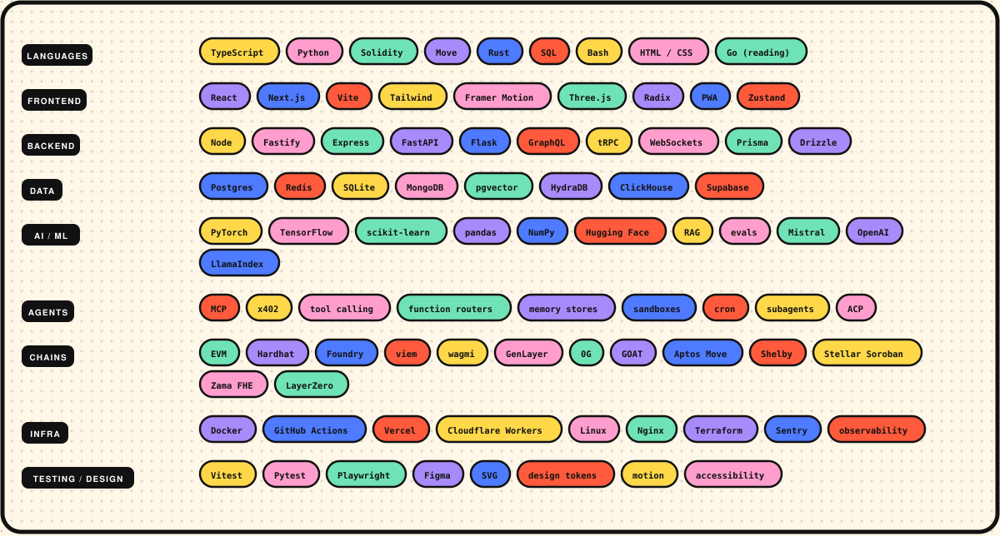

 

Open to work on agent infrastructure, settlement and adjudication, and hard reliability problems in long-running systems.

**`salmanch98@gmail.com`** · [X](https://twitter.com/salmanch_) · [LinkedIn](https://www.linkedin.com/in/salman-chhatwal-70339227a/)
